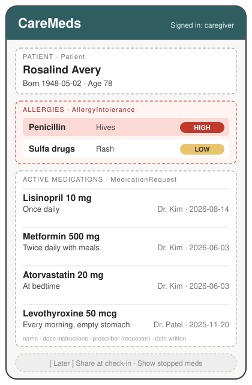

# Week 7 Notes: Planning My SMART App

Working notes for the Week 7 build tasks (nothing to submit). All patient details are fictional.

---

## Task 1: Fork the starter app

- Starter repository: [samoanGuy7/Smart-App](https://github.com/samoanGuy7/Smart-App)
- My fork: `github.com/amharper14/caregiver-med-review` *(name chosen to match the app idea)*
- Done when: I can open my own fork on GitHub. No downloading, code changes, or launching this week.

**What the starter already does** (from its README):

| File | Role |
|---|---|
| `launch.html` | Starts a **standalone launch** against the SMART Health IT R4 sandbox |
| `index.html` | Redirect target. Gets the token, then shows the patient's name, gender, birth date, and age |
| `health.html` | Hosting check for GitHub Pages |

Its scope today is `launch/patient openid fhirUser patient/Patient.read`. Same pieces as Week 5: patient context, identity, and read access to Patient.

---

## Task 2: Who my app helps

> **My app helps family caregivers to review a parent's current medications and allergies before a doctor's appointment by bringing the active prescriptions and recorded allergies together in one view.**

- **Who:** a family caregiver (the *user*), e.g., an adult child managing a parent's care
- **Patient in context:** the parent
- **What it helps them do:** walk into the appointment knowing what the parent is taking and what to avoid

This is the Week 5 "user vs. patient" example: John signs in, and his mother is the patient in context.

---

## Task 3: Information the app needs

| Information the app needs | FHIR resource | Details the app could display |
|---|---|---|
| Who the selected patient is | **Patient** | Name, birth date (age) |
| Current prescribed medications | **MedicationRequest** | Medication name, dose instructions, status (active), date written |
| Who prescribed each medication | **Practitioner** (via `MedicationRequest.requester`) | Prescriber name |
| Recorded allergies | **AllergyIntolerance** | Substance, reaction, criticality, clinical status |
| Medications the patient reports taking (OTC, supplements) | **MedicationStatement**? | Not sure yet. Bring to Open Build Hour. |
| Last pharmacy fill / refill date | **MedicationDispense**? | Not sure yet. Saved for *Later*. |

**Scopes I would likely request** (Week 5 format):
- `patient/Patient.rs`
- `patient/MedicationRequest.rs`
- `patient/AllergyIntolerance.rs`

Read + search only. The app displays information and never changes it.

**Questions for Open Build Hour**
1. Does the SMART R4 sandbox have MedicationRequest and AllergyIntolerance data for its test patients?
2. MedicationRequest (what was prescribed) vs. MedicationStatement (what the patient says they take): which fits a caregiver's view better?
3. Can the app show the prescriber's name without a separate Practitioner request?

---

## Task 4: First-version sketch

Working name: **CareMeds**

**Fictional example data on the sketch**
- Patient: Rosalind Avery, born 1948-05-02
- Active meds: Lisinopril 10 mg once daily · Metformin 500 mg twice daily with meals · Atorvastatin 20 mg at bedtime · Levothyroxine 50 mcg every morning
- Allergies: Penicillin (hives, **high** criticality) · Sulfa drugs (rash, low criticality)

**First version: three essential features**
1. **Patient header** showing who is in context (name, birth date, age)
2. **Active Medications** list with name, dose instructions, prescriber, and date written
3. **Allergies** section with substance, reaction, and criticality, high-criticality items first

**Later**
- "Show stopped medications" filter
- Last fill and refill-due dates (MedicationDispense)
- Share the list at check-in with a SMART Health Link (Week 6, Kill the Clipboard)
- Print-friendly "bring to appointment" view
- Notes field for questions to ask the doctor
- Switch between more than one person the caregiver helps
