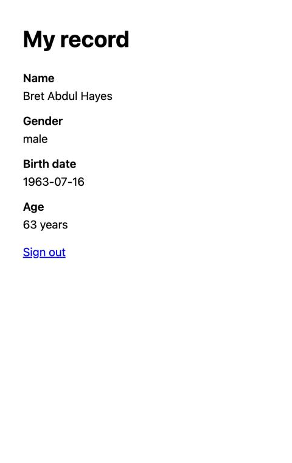

# Week 8 Notes: Trying the Starter App

Working notes for the Week 8 build tasks (nothing to submit). The patient shown is synthetic test data from the SMART Health IT R4 sandbox.

---

## Task 1: Open the starter app ✅

- Opened the course starter's `launch.html` (`samoanguy7.github.io/Smart-App/launch.html`)
- The app handed off to the **SMART sandbox Patient Login** page (demo only; any password works)
- Signed in as test patient **Bret Abdul Hayes** and approved access
- The sandbox redirected back to `index.html`, which showed the record

**What appears on the screen**

| Label | Value shown | Comes from |
|---|---|---|
| (page heading) | My record | Fixed text |
| Name | Bret Abdul Hayes | `Patient.name` (official name, given + family) |
| Gender | male | `Patient.gender` |
| Birth date | 1963-07-16 | `Patient.birthDate` (shown exactly as stored) |
| Age | 63 years | Calculated by the app from `birthDate` |
| Sign out | link | Clears the session |

That's the full Week 5 flow in action: launch → authorize → token → read the **Patient** resource → display it.

**My own fork:** GitHub Pages turned on (Deploy from a branch → main → /(root)) on 2026-11-21. Live at:
- App: https://amharper14.github.io/Caregiver-med-review/
- Sign-in: https://amharper14.github.io/Caregiver-med-review/launch.html (reaches the sandbox Patient Login)
- Health check: https://amharper14.github.io/Caregiver-med-review/health.html ✅

---

## Task 2: One thing I'd improve

**Activity: Make something easier to read**

- **Where:** the **Birth date** line, third item down
- **Now:** `1963-07-16` (the raw FHIR date format, year-month-day)
- **Change to:** `July 16, 1963`
- **Why:** a patient (or a caregiver checking a parent's record) reads a written-out date at a glance. The numeric form is easy to misread, especially when people are used to month/day/year.

**Other spots I noticed (for later)**
- *Change wording:* "My record" assumes the viewer is the patient. For my caregiver app it could say whose record it is.
- *Move something:* the name is just one line in a list. It could be the large heading at the top.
- *Make easier to read:* "male" is lowercase. It could display as "Male."
- *Add an instruction:* nothing tells a first-time user what the app can and can't show yet.

---

## Task 3: My sentence for next week

> **I'd like the app to show the birth date written out, like "July 16, 1963," so a patient can read and confirm it at a glance without decoding the year-month-day format.**

Small, single-spot change for the first vibe-coding session. In the code, it's the line in `index.html` that sets `birth-date` from `patient.birthDate`.
